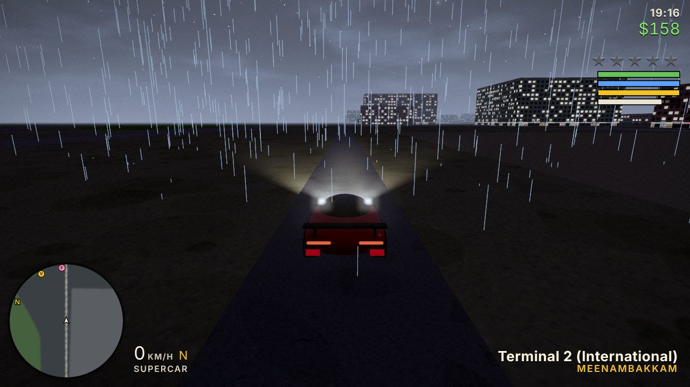

# Madras Hustle

An open-world crime game set on about 200 km² of real Chennai streets, built from OpenStreetMap data. It runs in the browser with Three.js and needs no install. Play with keyboard and mouse, or with a PS4/PS5 controller over USB or Bluetooth.



## What's in the open-world overhaul

| Area | What you get |
|---|---|
| **Airport** | Departures drop-off bay. A terminal interior with check-in desks, a security arch (it holds your weapons until you land) and a boarding gate. Two ways to fly: as a **passenger** on a scripted airliner (take-off, coastal loop, approach, landing, with a window seat or outside camera), or as the **pilot** of a charter plane on the runway |
| **Flight** | An arcade flight model with auto-levelling and trim assist. **Landing gear** (G); landing with the gear up damages the plane. A flight HUD with an artificial horizon, heading tape, airspeed, altitude, vertical speed, throttle, gear state, STALL and PULL UP warnings |
| **Metro** | A street entrance at every station. Inside: a concourse with ticket machines, **turnstiles that only open with a token**, and a platform with a departure board. A Blender-modelled train pulls in and its doors slide open. You then ride a **real train along the real line**, with seated passengers, outside or seated-at-the-window views, and skip-ahead. You step off into the destination station |
| **Vehicles** | Same arcade driving model (accelerate, brake, reverse, steer, handbrake). Adds a **gear readout** (R / N / 1–6) and **headlights** (G cycles auto / on / off) with soft volumetric beams |
| **World fixes** | Runs on load: rail heights unified at junctions, grades limited, cliffs removed. Viaducts that ended in mid-air now ramp into **tunnel portals**, and twin tracks are lifted onto their decks. **35 elevated metro stations** were built. Road dead ends a few metres short of another road were stitched (81). Buildings on rail corridors (55) and the airside (3) removed, 1,964 trees cleared from the airport infield. An airport **perimeter fence** with gaps for access roads |
| **Colliders & layers** | `Default / Road / Obstacle / Interactable / Curb / Water`. Platform edges are `Curb`: cars are blocked, people step up. Buildings with a road through them keep every wall except the road opening (previously they had no collision at all). Bridge railings drawn on every bridge, and a fall-through-world failsafe |
| **UI** | Main menu (Play, Missions, Settings, Controls, Exit) and pause menu (Missions, Settings, Save, Quit to menu). Settings cover graphics, time, weather, sound, camera sensitivity, invert Y and speed blur. A missions list with Set GPS, a mission **briefing** overlay, an objective tracker, reward banners, and minimap blips for the airport, metro, family home and cafes |
| **Living world** | Enterable airport terminal, metro stations, cafes and the **family home** in Mylapore, all with populated NPCs, some of them seated. **Data-driven dialogue** (`data/dialogue.json`) with Amma, Karthik and Selvi; your choices change **relationship** scores |
| **Cheats** | Type a code during play, GTA style, or open the console with <kbd>`</kbd>: `HEALME`, `GIVECASH [n]`, `SPAWNCAR [type]`, `SETWEATHER [clear/cloudy/rain/fog/storm]`, `CLEARWANTED`, `SKYFALL`. Every cheat goes through the normal game APIs, and saves are sanitised before they are written |
| **Missions** | An event-driven framework: Trigger → Briefing → Checkpoints → Fail/Success → Reward. Three new missions: **The Arrival**, **Commuter Hustle** and **Family Favor**, plus the original 12 |
| **Graphics** | **Blender-built models** for the airliner, prop plane, helicopter, metro coaches (with sliding doors), supercar, palm and neem trees. A **weather system** (rain streaks, storms with lightning, fog, wet glossy roads, overcast skies) and a cinematic grade pass (contrast, vignette, speed blur with chromatic aberration, grain, damage pulse) |

## Play locally
```
python3 build.py        # writes dist/index.html (and copies world data)
cd dist
python3 -m http.server 8000
```
Open http://localhost:8000. You need a web server; opening `index.html` directly won't load the map data or the 3D models.

## Deploy to Vercel (anyone can play)
**Option A, drag and drop:** go to https://vercel.com/new, choose "Deploy" with no framework, and upload this folder. `vercel.json` already points to `dist/`.

**Option B, CLI:** `npm i -g vercel`, then `vercel` and `vercel --prod` from the repo root (no framework, no build command).

**Option C, GitHub:** import the repo at vercel.com/new, set Framework = Other, Output Directory = `dist`.

## Controls
| Action | Keyboard | PS4 |
|---|---|---|
| Move / drive | WASD | Left stick |
| Camera | Mouse | Right stick |
| Enter / exit vehicle, board / leave train or plane | F | Triangle |
| Interact: shops, doors, missions, ticket machine, turnstile, check-in, gate, talk | E | D-pad right |
| Headlights (car) · landing gear (plane) | G | L3 |
| Aim / shoot | Right / left mouse | L2 / R2 |
| Sprint / jump | Shift / Space | X / Square |
| Weapons | 1-8, wheel | L1 / R1 |
| Camera distance · passenger cabin / outside view | C | D-pad left |
| Passenger: skip ahead | hold E | hold D-pad right |
| Map | M | Touchpad |
| Pause | Esc / P | Options |
| Day / night | L | Share |
| Cheat console | ` | — |
| Dialogue choices | 1-9 or ↑ ↓ + Enter | D-pad + X |

**Planes:** Space / Shift throttle, W / S nose down / up, A / D roll, Q / E rudder, G gear. **Helicopter:** Space / Shift climb / descend, W / S tilt, A / D turn, Q / E strafe.

## The three new missions
1. **The Arrival** (Priya, marker near your safehouse). Get a car and drive to the departures drop-off. Walk into the terminal, buy the charter at check-in, clear security and board at Gate 4. Then take off and land the plane on the beach landing zone (Marina).
2. **Commuter Hustle** (Anand, marker at the metro station nearest home). Enter the station, buy a token to the named elevated station and tap in. Board when the doors open, ride across town and step off. Grab the briefcase from the platform bench and leave the station.
3. **Family Favor** (Amma, marker at the family home in Mylapore, or accept the favour in conversation). Visit home and talk to Amma. Get in Appa's Ambassador and deliver it to Uncle Raju's garage before the timer runs out. The mission fails if the car drops below 40 % health.

## Architecture
The code is an ES module concatenated from `src/` in numeric order by `build.py`. It is organised like a Unity project: an event bus (observer pattern), registered systems, trigger volumes, collision layers and data-driven content. See [docs/ARCHITECTURE.md](docs/ARCHITECTURE.md) for the module map and the Unity / C# equivalent of each piece.

```
src/00_core.js          input (keyboard, mouse, gamepad), synth audio
src/01_events.js        EventBus, Layers, Systems registry, Triggers, contextual prompts
src/05_textures.js      procedural facade / road textures
src/06_assets.js        GLB loader for the Blender models (procedural fallback)
src/08_worldfix.js      load-time world geometry fixes (rail, roads, airport, corridors)
src/10_world.js         renderer, post-processing, sky, collision walls, spatial queries
src/11_build.js         city builder, chunk streaming, rails, portals, elevated stations, airport fence
src/12_people.js        articulated people, weapons models
src/13_weather.js       weather system + cinematic grade pass
src/20_vehicles.js      vehicle physics (car / boat / heli / plane), trains with sliding doors
src/30_ai.js            traffic, pedestrians, police
src/35_weapons.js       weapons, pickups
src/36_economy.js       money, shops, interiors (with internal walls), properties
src/37_airport.js       terminal, check-in, security, gate, passenger + pilot flights
src/38_transit.js       train boarding, airliner traffic, ships
src/39_metro.js         metro stations, token machine, turnstiles, platform, rides
src/40_game.js          player, camera, HUD, minimap, main loop, boot
src/41_ui.js            menus, settings, missions list, briefing, objective tracker, flight HUD
src/44_living.js        dialogue engine, relationships, family home, cafes
src/45_missions.js      mission framework + original missions
src/46_missions_new.js  The Arrival, Commuter Hustle, Family Favor
src/48_cheats.js        cheat registry, console, save sanitiser
data/dialogue.json      dialogue trees (inlined into the build)
tools/blender/          Blender asset pipeline (build_assets.py) + contact-sheet renderer
tools/e2e/              headless end-to-end test that plays every loop
tools/analyze_*.mjs     world-data audits
```

### Rebuild the 3D models (Blender)
```
pip install bpy                         # Blender as a Python module (or use the Blender app)
python tools/blender/build_assets.py    # writes dist/assets/*.glb
python tools/blender/preview.py -- out.png   # optional contact sheet (Cycles, CPU)
```

### Run the end-to-end tests
```
cd tools/e2e && npm install && npx playwright install chromium
node run.mjs loops.mjs        # boots the real game headless and plays every loop; screenshots in tools/e2e/out/
```
The harness serves `dist/` from memory and maps the three.js CDN to the local copy, so it runs offline.

### Rebuild the map (optional)
The `data/` scripts download OpenStreetMap tiles (`fetch2.py`), parse them (`parse2.py`), turn them into game geometry (`process2.py`, which needs `shapely`), and compress and split the result (`pack.py`). The output is `world-a.json` and `world-b.json`. `node tools/analyze_world.mjs` and `node tools/analyze_overlap.mjs` audit the data for floating decks, rail grades and airport overlaps.

## Verified (headless Chromium, `tools/e2e/loops.mjs`, 20 / 20 checks passing)
Boot with all 8 Blender models. The cheat console typed for real, and a GTA-style typed code. The save sanitiser. Driving with forward gears, reverse showing R, the headlight cycle and exiting. Airport: check-in → closed security blocks you without a pass → security → gate → charter plane → real take-off to around 300 m with the gear up and the flight HUD. Passenger flight from take-off to landing and deplaning (weapons returned). Metro: the turnstile blocks you without a token → token → tap in → train arrives → board → ride → step off at the destination station. Dialogue changes the relationship score. Settings persist, and the missions list shows all 15. **The Arrival**, **Commuter Hustle** and **Family Favor** all play through and pass, and a fail condition fires. The fall-through failsafe works. Collision layers: all 456 platform edges block cars, and people step onto 441 of them (the rest have a building behind).

## Known limitations
- The project stays on the WebGL runtime. No Unity editor was available to build or verify a Unity project, so the C# architecture is mirrored in JS (see docs/ARCHITECTURE.md) rather than ported.
- The rail profile is fixed at load time. A few short crossover fragments (under 300 m) near the Alandur / airport interchange still dip under a viaduct, and 9 segments are steeper than 4.5 % (max 7 %).
- The metro and airport interiors are shared rooms (one terminal, one station layout reused for every stop). The world trains are real, but boarding happens through the interior platform.
- The Blender-modelled sedan and auto-rickshaw are in the pipeline but not shipped; the game keeps its procedural versions of those.
- Typing a cheat during play also triggers the keys' normal actions (as in GTA). The console (`) avoids that.

Map data © OpenStreetMap contributors (ODbL).
